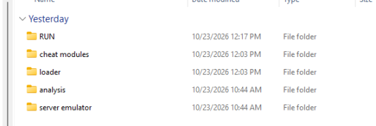

# avalon ai crack

i cracked avalon ai, its a color aimbot that works on a ton of games. cs2, valorant, fortnite, apex, rust, cod, overwatch and like 20 more

pretty old crack of mine, not 100% finished, has a bug here and there but it works. everything is in the repo. packed and unpacked loader, all the modules, the yolo model, the server emulator i made for the license bypass, and the whole menu decompiled

if u get this from anywhere other than here its probably a rat

## whats in each folder

**RUN** : ready to run copy, launch XmlHelper.exe

**loader** : the loader. original packed version, the unpacked dump, and the AvalonML part

**cheat modules** : the main dlls, the yolo aim model, and 2 modules i never bothered figuring out

**server emulator** : the proxy and certs that pretend to be avalons servers, this is the license bypass

**analysis** : the entire menu decompiled. full wpf project with all the baml files and themes

## how the crack works

1. capture_server.py fakes avalons backend and answers the license checks
2. the certs in there let it MITM the loaders traffic
3. run XmlHelper.exe and it talks to your local server instead of the real one
4. loader then loads everything in cheat modules. the yolo model detects players on screen, overlay_skiaSharp.dll draws the esp, gui_wpf.dll is the menu
5. the unpacked folder in loader is the dump i made for static analysis, thats how i got into all this

## every file explained

FILE_INDEX.md has every single file in the repo listed with what it is

## screenshots

.webp>)
.webp>)
.webp>)
.webp>)
.webp>)
.webp>)
